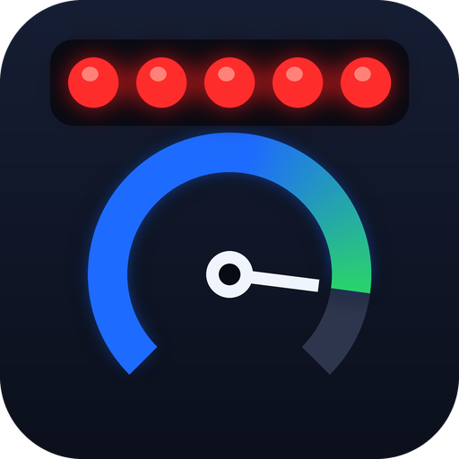

# Spool Up: 2026 Race Starts — F1 25 addon (Swofty) — beta



F1 25's 2026 Season Pack brings the 2026 cars, but not the 2026 start. Spool Up adds it: the blue Pre-Start lights, a turbo you spool yourself, AI cars that can get it wrong, and the low-output safety net.

The real 2026 cars have no MGU-H, so nothing keeps the turbo spinning on the grid. Drivers build boost on the revs before lights out, and the FIA added a five-second warning to give them the time ([why, on Formula1.com](https://www.formula1.com/en/latest/article/explained-why-race-starts-will-be-different-in-2026.7ADR4zkfl299T7i3ZYVTYK)). Get it wrong here and the grid drives away from you.

**Download:** install it from the Addon Browser in the Swofty Launcher, or get the zip from [Releases](https://github.com/nyannoying1337/f1-25-spool-up/releases) and import it.

## What you get

- **Pre-Start.** For 5 s before the first red light the light panels along the track flash blue, the five lamps of the game's own start lights on your HUD flash blue, and the game's lap counter says PRE-START. Then the game's own five lights. Also after a formation lap and at a standing restart.
- **Turbo spool.** A TURBO SPOOL gauge under the start lights, drawn by the game's own HUD. Move it, resize it or turn it off in the game's HUD customisation, where it is called Turbo Spool. Hold 10,000 rpm or more and it fills in 3 s, then turns green and says FULL. Drop below that while you wait and it falls again. With an empty gauge the engine has about a third of its power when the lights go out.
- **Low-output safety net.** A car on low boost that accelerates abnormally slowly gets just enough MGU-K from its own battery to hold a minimum acceleration until 50 km/h. The game's own message box shows LOW-OUTPUT START, or SLOW CAR AHEAD when it is an AI car in front of you. The net turns a disastrous start into a bad one, never a good one.
- **AI that can get it wrong.** Each AI car gets a random start: most are clean, some poor, about 1 in 20 fumbled. A fumbled car bogs for 1.5 s, so gaps open up on the grid.
- **No MGU-K off the line.** The game's 2026 car data already has no deployment below 50 km/h, as in the rules. Spool Up keeps it that way for every car the net does not help.

## How to start

1. Race with the F1 2026 cars, with or without a formation lap.
2. When the lights flash blue, hold 10,000 rpm or more until the TURBO SPOOL gauge says FULL. Keep the revs up through the red lights.
3. Go when the lights go out. You have no MGU-K until 50 km/h.

## What a start costs

Time from lights out to 50 km/h, measured in the game with the default settings (Shanghai):

| Start | To 50 km/h |
|---|---|
| You, bar 75 to 100 % | 1.8 to 1.95 s |
| You, bar 60 to 70 % | 2.05 to 2.2 s |
| You, bar under 30 % | about 3.5 s |
| AI cars, median of the grid | 2.0 to 2.3 s |
| A fumbled AI car | 3.0 to 3.4 s |

## Requirements

- F1 25 on Steam, build 25251167. The EA app version is not supported. After a game update Spool Up stays idle and the game runs as normal, until a new version is out.
- The official 2026 Season Pack, for the F1 2026 cars.
- Swofty Launcher 1.8.38 or newer.
- Offline Grand Prix, Driver Career or My Team, races and sprints.

Other cars keep the game's normal start. Spool Up reads every car at the lights, and a grid with any non-2026 ERS car stays standard.

## Settings

In ADDON SETTINGS on the home menu (directly under Career, or F9 / R3), or in the launcher. **Custom settings are untested so far:** every start raced so far ran on the defaults.

| Setting | Default | What it does |
|---|---|---|
| Pre-Start phase | On | The 5 s blue phase before the first red light |
| 2026 launch physics | On | The turbo spool and the random AI starts. Off gives every car the game's normal launch |
| Low-output start safety net | On | The MGU-K help and the warnings |
| Apply launch physics to AI | On | Off gives every AI car a normal launch, with no bad starts, which makes your start much harder |
| Turbo spool time (s) | 3 | 1 to 8: seconds at high revs to reach full boost |
| Spool revs (rpm) | 10,000 | 6,000 to 14,000: the engine speed above which the turbo gains boost |

## Beta status

- Raced so far: Driver Career races at Shanghai and Suzuka and a two-round Grand Prix, with the default settings. My Team and sprints run the same code.
- **Custom settings are untested** in a real race.
- Not tried in a real race yet either: a start after a driven formation lap, a grid of non-2026 cars and the warnings in the game's message box.
- The trackside panels flash blue in the game's log, but nobody has seen them on screen yet.

## Good to know

- The start lights on the gantry stay the game's own: they have no blue lamps. How many blue panels you can see from your grid slot depends on the track, and the blue lamps on your HUD show at every track. The warnings are messages on your HUD, not lights on the cars.
- The blue lamps, the spool gauge, PRE-START and the warnings are all drawn by the game's own HUD, so they follow its layout and scale. Only when the game's HUD is missing or refuses them does Spool Up draw them itself.
- DLSS Frame Generation does not hide the blue lamps or the gauge, because the game draws them. Spool Up's own drawing, used only when the game's HUD refuses them, does not show with Frame Generation on.
- Aborted starts and extra formation laps (FIA Articles B5.8 and B5.9) are not added.
- AI starts are random. Driver skill does not change them.
- The net's MGU-K is what the game's deploy code allows: none in ERS mode None, none with an empty battery.
- Online, split screen, Story and F1 World keep the game's own start.
- Works alongside [Terminal Damage](https://github.com/nyannoying1337/f1-25-terminal-damage).

**Something not working?** Each part has its own setting: turn off only that part for now and send me your `loader.log` (newest folder in `%LOCALAPPDATA%\Swofty\sessions`) in an [issue](https://github.com/nyannoying1337/f1-25-spool-up/issues).

## FIA rules and what is not from the FIA

| Part | Source |
|---|---|
| Pre-Start | Section B, Article B5.7.2 b: "Grid Light Panels will be illuminated blue (flashing) for five (5) seconds and the message "Pre-Start" will be displayed" |
| No MGU-K off the line | Section C, Article C5.2: "During a standing start from the grid the MGU-K may only be used once the car has reached 50 km/h" |
| Safety net | Article C5.2 allows the MGU-K below 50 km/h "for the purpose of maintaining a minimum vehicle acceleration", "only to the extent necessary". The [FIA's statement of 20 April 2026](https://api.fia.com/news/refinements-2026-fia-formula-1-regulations-agreed-all-stakeholders) describes "low power start detection" for "abnormally low acceleration shortly after clutch release" |
| Turbo spool and AI starts | No FIA figures. These are game models |

The FIA has not published its trigger values, so these are my own tuning values:

- 3 s to spool at 10,000 rpm or more. Boost falls at half that rate while you wait below the revs. After lights out it only rises, because the revs always drop when the clutch bites.
- 35 % engine power at zero boost.
- Safety net: checked 1 s after the car starts moving, for under 4.5 m/s² gained with under 50 % boost. A car with more boost than that has grip or driver trouble, so a wet start does not flag the whole grid.
- AI boost at lights out: 75 % of cars 50 to 100 %, 20 % of cars 20 to 50 %, 5 % of cars 0 to 20 %. After lights out AI boost refills at any revs, except that a car under 20 % keeps what it has for the first 1.5 s.

## How it works

- Which starts: the mode from Swofty's `session.start` (Grand Prix, Driver Career or My Team; Swofty reports online modes as unknown), then the game's own session type at the start lights, race or sprint. Swofty's session name stays on the weekend's first session, so it only counts when the game's type cannot be read.
- `Sess_StartLights_Enter` (wrap): reads every car from the core's car table before it changes anything, then adds 5 s to the game's own countdown. The game's update counts it down, stops it while paused, then starts the lights.
- `Sess_MarshalLights_UpdateZoneShader` (wrap, per panel, per tick): during Pre-Start it writes the game's own blue flag values, or its own off values on the flash's other half, just before the game sends them to the panel's shader. The game writes each panel again on its next tick, so nothing needs putting back.
- `Car_Powertrain_Step` (wrap, per car, 360 Hz): reads engine speed, car speed, physics time and what the game deployed. For a car the safety net flagged, below 50 km/h, it makes that car's own deploy curve answer the share it needs for the length of the game's call, then puts the curve back. Everything past the curve is the game's own: the ERS mode's limit, the energy, the torque clamp, the throttle split and the brake and idle gates.
- Engine power goes through `engine.power_scale` layers at priority 40, under Terminal Damage's fault scale (50) and engine kill (100).
- The words go through the core's race HUD (`SwoftyCoreHud`): PRE-START into the lap counter's own leaves, written again every half second while it shows, and the warnings into the game's message box. The blue lamps and the gauge are game HUD parts: `erp` overlays add them to the race screen (`race_main.idf`, `race.ui`) and add a HUD element `spool_gauge` (template `hud_spool_gauge`, entry in `hud_layouts.uidl`), driven by 19 `view_model_data.hud_spool_*` leaves. `tools/native_hud/build.py` makes those archives from the game's own files. Swofty's overlay draws them only when the game HUD refuses a write.

To check that it runs, look in the log (`swofty\loader.log` in your F1 25 folder, while the game runs) for:

```
[gridstart] 0.3.0 ready: build check ok, ...
[gridstart] StartLights enter: 23 cars, 22 F1 2026, 0 others with an ERS (handling version 9, max deploy 350000 W)
[gridstart] run started: game delay 0.00 s, Pre-Start +5.00 s, launch model on, safety net on, AI on, spool 3.0 s at 10000 rpm
[gridstart] lap counter shows PRE-START
[gridstart] game HUD lights and gauge: on (19 leaves)
[gridstart] Pre-Start panels: U zone updates in T ticks, S with shaders on, M with a panel model, B blue; session state 0xN
[gridstart] LIGHTS OUT after W s of waiting (...); C cars seen, player car N, boost B%, peak P rpm
```

## Build

`.\package.ps1 -NoInstall` runs the tests, builds `native\grid_start_2026.dll` and writes the zip to `dist\` (zig 0.17). `native\build.cmd` runs the tests and builds only.

## License

[Spool Up Attribution License 1.0](LICENSE). `native/include/swofty_api.h` keeps its MIT license.

Fan-made. Not affiliated with or endorsed by the FIA, Formula 1, EA or Codemasters.
